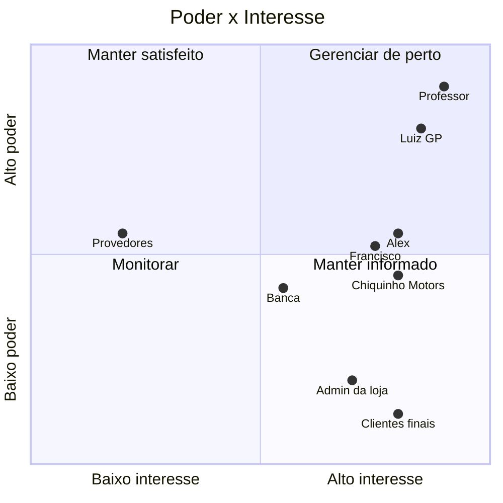

# Registro das Partes Interessadas

> **Processo PMBOK:** 10.1 Identificar as partes interessadas
> **Área:** Gerenciamento das Comunicações · **Grupo:** Iniciação
> **Versão:** 1.0 · 29/10/2026

Identifica **todas as pessoas e grupos** afetados pelo projeto, o que cada
um espera e quanto pode influenciar o resultado. Detalha a §10 do
[Termo de Abertura](Termo-de-Abertura.md) e alimenta o
[Plano de Gerenciamento das Comunicações](../02-Planejamento/Plano-de-Gerenciamento-das-Comunicacoes.md).

---

## 1. Como as partes interessadas foram identificadas

| Fonte | O que revelou |
|-------|---------------|
| Termo de Abertura (§10 e §11) | Patrocinador, equipe, cliente e usuários |
| Regras da disciplina | Banca/turma como avaliadores das apresentações |
| Escopo e EAP | Dois tipos de usuário do sistema: cliente do site e administrador do painel |
| Arquitetura e `docs/DEPLOY.md` | Provedores de que o projeto depende (GitHub, Coolify/Hetzner) |

## 2. Registro

| ID | Parte interessada | Tipo | Papel no projeto | Requisitos principais | Expectativas | Interesse | Poder |
|----|-------------------|:----:|------------------|----------------------|--------------|:---------:|:-----:|
| PI-01 | Professor(a) da disciplina | Externa | **Patrocinador** · avaliador · aceite final | Artefatos PMBOK completos; sistema funcionando | Projeto que aplica o PMBOK de verdade, entregue no prazo e apresentado com clareza | Alto | Alto |
| PI-02 | Banca / turma | Externa | Avaliadores e ouvintes das apresentações | Apresentação no tempo, demonstração ao vivo | Entender o problema, a solução e ver o sistema rodando | Médio | Médio |
| PI-03 | Luiz Henrique Mota | Interna | Gerente do projeto · desenvolvedor | Equipe participando; decisões registradas | Boa nota; projeto de portfólio | Alto | Alto |
| PI-04 | Alex Pablo de Oliveira Moraes | Interna | Desenvolvedor · revisor | Pacotes claros; ambiente funcionando | Boa nota; aprender Prisma/Vue na prática | Alto | Médio |
| PI-05 | Francisco de Julio Faria | Interna | Desenvolvedor · apresentador | Pacotes claros; acesso ao repositório | Boa nota; contribuição reconhecida | Alto | Médio |
| PI-06 | Chiquinho Motors® (cliente fictício) | Externa | Dono do negócio simulado | Os quatro negócios em um só sistema | Vender peças e serviços pelo site; gerenciar sem editar código | Alto | Médio |
| PI-07 | Administrador(a) da loja | Usuário | Opera o painel `/admin` | Login seguro, CRUD, fila de pedidos e agenda | Painel simples, sem depender de programador | Alto | Baixo |
| PI-08 | Clientes finais da concessionária | Usuário | Navegam, compram e agendam no site | Catálogo com compatibilidade, carrinho, agendamento | Site rápido, acessível e funcionando no celular | Alto | Baixo |
| PI-09 | Provedores (GitHub, Coolify/Hetzner) | Externa | Repositório, CI, banco e hospedagem | Uso dentro dos planos gratuitos | — (serviço) | Baixo | Médio |

PI-06, PI-07 e PI-08 são **personas** — o negócio é fictício
(premissa do Termo de Abertura). Quem fala por elas no projeto é a
própria equipe, guiada pelos requisitos.

## 3. Classificação (poder × interesse)

| Quadrante | Partes interessadas | Estratégia |
|-----------|--------------------|------------|
| **Gerenciar de perto** | PI-01 Professor(a), PI-03/04/05 Equipe | Envolver nas decisões; comunicação frequente e bidirecional |
| **Manter satisfeito** | PI-09 Provedores | Respeitar limites dos planos gratuitos; acompanhar indisponibilidades |
| **Manter informado** | PI-02 Banca, PI-06 Cliente, PI-07 Admin, PI-08 Clientes finais | Apresentações, README, site publicado |
| **Monitorar** | — | — |

## 4. Estratégia de gerenciamento

| ID | Engajamento atual | Engajamento desejado | Como chegar lá |
|----|:-----------------:|:--------------------:|----------------|
| PI-01 | Apoiador | Apoiador | Status por apresentação; consultar em mudanças de alto impacto |
| PI-02 | Neutro | Apoiador | Demonstração ao vivo e roteiro ensaiado |
| PI-04 | Apoiador | Líder em pacotes | Designar o deploy (1.7.3) e revisões ([Mobilização](../03-Execucao/Mobilizacao-da-Equipe.md)) |
| PI-05 | Neutro (sem acesso ao repositório) | Apoiador ativo | Acesso ao GitHub, pacote próprio e par de programação (RH-03) |
| PI-06–08 | Representados pelos requisitos | Atendidos | Critérios de aceitação e testes E2E dos fluxos de cliente e admin |

## 5. Atualização

O registro é revisto **a cada fase** e quando surgir parte interessada
nova (ex.: um usuário real testando o site publicado).
