# EAP — Estrutura Analítica do Projeto

> **Processo PMBOK:** 5.4 Criar a EAP
> **Área:** Gerenciamento do Escopo · **Grupo:** Planejamento
> **Versão:** 1.0 · 12/10/2026 · **Faz parte da linha de base do escopo**

A EAP é **orientada a entregas** e decomposta por fase. O nível mais baixo
(pacote de trabalho) é pequeno o suficiente para ser entregue em **um Pull
Request** e verificado individualmente.

---

## 1. Diagrama

```mermaid
flowchart TD
    P["1 Chiquinho Motors®"]

    P --> F0["1.1 Fundação técnica (F0)"]
    P --> F1["1.2 Persistência e Veículos (F1)"]
    P --> F2["1.3 Peças e Acessórios (F2)"]
    P --> F3["1.4 Carrinho e Checkout (F3)"]
    P --> F4["1.5 Serviços e Agendamento (F4)"]
    P --> F5["1.6 Área Administrativa (F5)"]
    P --> F6["1.7 Qualidade e Publicação (F6)"]
    P --> GP["1.8 Gerenciamento do Projeto"]

    F0 --> F01["1.1.1 Estrutura front/back"]
    F0 --> F02["1.1.2 Segurança e validação"]
    F0 --> F03["1.1.3 Contato e 404"]
    F0 --> F04["1.1.4 Design system"]
    F0 --> F05["1.1.5 Lint, testes e CI"]

    F1 --> F11["1.2.1 Setup PostgreSQL + Prisma"]
    F1 --> F12["1.2.2 Modelagem de veículos"]
    F1 --> F13["1.2.3 API de veículos"]
    F1 --> F14["1.2.4 Telas de veículos"]

    F2 --> F21["1.3.1 Modelagem Produto + compatibilidade"]
    F2 --> F22["1.3.2 API de peças/acessórios"]
    F2 --> F23["1.3.3 Telas de catálogo"]
    F2 --> F24["1.3.4 Seed do catálogo"]

    F3 --> F31["1.4.1 Modelagem Pedido/Cliente"]
    F3 --> F32["1.4.2 API de pedidos"]
    F3 --> F33["1.4.3 Store do carrinho"]
    F3 --> F34["1.4.4 Telas carrinho/checkout/pedido"]

    F4 --> F41["1.5.1 Modelagem Serviço/Agendamento"]
    F4 --> F42["1.5.2 API de disponibilidade"]
    F4 --> F43["1.5.3 API de agendamento"]
    F4 --> F44["1.5.4 Telas de serviços/agendamento"]

    F5 --> F51["1.6.1 Autenticação admin"]
    F5 --> F52["1.6.2 CRUD protegido"]
    F5 --> F53["1.6.3 Gestão de pedidos e agenda"]
    F5 --> F54["1.6.4 Telas do painel"]

    F6 --> F61["1.7.1 Testes E2E"]
    F6 --> F62["1.7.2 Acessibilidade e performance"]
    F6 --> F63["1.7.3 Deploy público"]
    F6 --> F64["1.7.4 README final"]

    GP --> G1["1.8.1 Iniciação"]
    GP --> G2["1.8.2 Planejamento"]
    GP --> G3["1.8.3 Monitoramento e controle"]
    GP --> G4["1.8.4 Apresentações"]
    GP --> G5["1.8.5 Encerramento"]
```

## 2. EAP em formato de lista (com status)

- **1 Chiquinho Motors®**
  - **1.1 Fundação técnica (F0)** — ✅
    - 1.1.1 Estrutura `frontend/` + `backend/` (Vue 3 + Express) — ✅
    - 1.1.2 Segurança e validação (Helmet, rate limit, Zod, tratamento de erros) — ✅
    - 1.1.3 Formulário de contato (`POST /api/contato`) e páginas 404 — ✅
    - 1.1.4 Design system "Carbon & Racing Red" + ícones Lucide — ✅
    - 1.1.5 ESLint/Prettier, Vitest, GitHub Actions, LICENSE/CHANGELOG — ✅
  - **1.2 Persistência e Veículos (F1)** — ✅
    - 1.2.1 Setup PostgreSQL (Coolify) + Prisma + migrations — ✅
    - 1.2.2 Modelagem `Marca`, `Carro`, `CarroImagem` — ✅
    - 1.2.3 API `/api/carros`, `/api/carros/:id` — ✅
    - 1.2.4 Telas `CarrosView` e `CarroDetalheView` + imagens locais — ✅
  - **1.3 Peças e Acessórios (F2)** — ✅
    - 1.3.1 Modelagem `Produto`, `Categoria`, `ModeloVeiculo`, `ProdutoCompatibilidade` — ✅
    - 1.3.2 API `/api/pecas`, `/api/acessorios`, `/api/categorias`, `/api/modelos`, `/api/carros/:id/pecas` — ✅
    - 1.3.3 Telas `PecasView`, `AcessoriosView`, `ProdutoDetalheView` + store Pinia — ✅
    - 1.3.4 Seed idempotente do catálogo — ✅
  - **1.4 Carrinho e Checkout (F3)** — ✅
    - 1.4.1 Modelagem `Pedido`, `PedidoItem`, `Cliente` — ✅
    - 1.4.2 API `POST /api/pedidos` (transação + estoque) e `GET /api/pedidos/:codigo` — ✅
    - 1.4.3 Store Pinia `carrinho` com persistência — ✅
    - 1.4.4 Telas `CarrinhoView`, `CheckoutView`, `PedidoView` + mini-carrinho — ✅
  - **1.5 Serviços e Agendamento (F4)** — ✅
    - 1.5.1 Modelagem `Servico`, `Agendamento` (trava de horário) — ✅
    - 1.5.2 API de disponibilidade de horários — ✅
    - 1.5.3 API de agendamento + consulta por código — ✅
    - 1.5.4 Telas `ServicosView`, `AgendamentoView`, confirmação — ✅
  - **1.6 Área Administrativa (F5)** — 🟡
    - 1.6.1 Autenticação (modelo `Administrador`, login JWT, middleware, store `auth`) — ✅
    - 1.6.2 CRUD protegido do catálogo + upload de imagem — ⬜
    - 1.6.3 Status de pedidos/agendamentos + caixa de mensagens — ⬜
    - 1.6.4 Telas do painel (login ✅, dashboard 🟡, listas/formulários ⬜) — 🟡
  - **1.7 Qualidade e Publicação (F6)** — ⬜
    - 1.7.1 Testes E2E (Playwright) — ⬜
    - 1.7.2 Lighthouse ≥ 90, SEO, lazy loading — ⬜
    - 1.7.3 Deploy (Vercel/Netlify + Railway/Render) — ⬜
    - 1.7.4 README final com instruções de deploy — ⬜
  - **1.8 Gerenciamento do Projeto** — 🟡
    - 1.8.1 Termo de abertura — ✅
    - 1.8.2 Plano de gerenciamento, requisitos, escopo, EAP — ✅
    - 1.8.3 Relatórios de desempenho e controle de mudanças — ✅ (contínuo)
    - 1.8.4 1ª apresentação ✅ · 2ª apresentação ⏳
    - 1.8.5 Termo de encerramento e lições aprendidas — 🟡 (encerramento de fase feito)

## 3. Dicionário da EAP

| Código | Pacote | Descrição / entregável | Critério de aceitação | Responsável | Esforço |
|--------|--------|------------------------|----------------------|-------------|:-------:|
| 1.1.5 | Lint, testes e CI | Configs de lint, testes mínimos de API e componentes, workflow do GitHub | `lint` e `test` verdes no CI; PR bloqueado se falhar | Equipe | 3 d |
| 1.2.1 | Setup PostgreSQL | Prisma configurado, `DATABASE_URL`, migrations | `prisma migrate dev` aplica sem erro | Alex | 1 d |
| 1.2.3 | API de veículos | Rotas + serializer `carroView` | Lista 200; slug inexistente 404 | Alex | 1 d |
| 1.3.1 | Modelagem Produto | Produto unificado + junção N:N com modelos | Migration aplicada; FKs com cascade | Alex | 1 d |
| 1.3.2 | API de catálogo | Fábrica `criarRotasProduto(tipo)` com filtros | `?modelo=` retorna só compatíveis | Alex | 2 d |
| 1.3.3 | Telas de catálogo | `CatalogoProdutos`, `CardProduto`, `useProdutos` | Filtros funcionam com debounce | Alex / Francisco | 2 d |
| 1.4.2 | API de pedidos | Criação de pedido em transação | Estoque nunca negativo; 409 se faltar | Luiz | 3 d |
| 1.4.4 | Telas de compra | Carrinho, checkout e acompanhamento | Fluxo completo até o código do pedido | Luiz | 4 d |
| 1.5.2 | Disponibilidade | Geração de slots livres por dia/serviço | Retorna só horários não ocupados | Luiz | 2 d |
| 1.5.3 | Agendamento | Reserva com trava única | Conflito → 409 "horário indisponível" | Luiz | 2 d |
| 1.6.1 | Autenticação | `Administrador`, bcrypt, JWT, `verificarAdmin`, store `auth` | Login válido gera token; rotas protegidas → 401 sem token | Luiz | 3 d |
| 1.6.2 | CRUD protegido | POST/PUT/DELETE de carros, produtos, categorias, serviços | Item criado no painel aparece no site | A definir | 5 d |
| 1.7.3 | Deploy | Front e back publicados, `migrate deploy` | URL pública abre sem instalar nada | A definir | 2 d |
| 1.8.4 | Apresentações | Slides + roteiro | Apresentado no tempo para a banca | Equipe | 2 d |

> Pacotes marcados "A definir" serão atribuídos na reunião de
> planejamento de cada fase.
