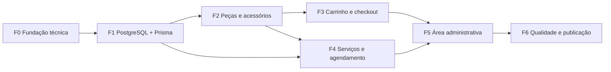

# Plano de Gerenciamento do Projeto

> **Processo PMBOK:** 4.2 Desenvolver o plano de gerenciamento do projeto
> **Área:** Gerenciamento da Integração · **Grupo:** Planejamento
> **Versão:** 1.0 · 12/10/2026

Este plano consolida **como** o projeto é planejado, executado, monitorado
e encerrado. Ele integra os planos auxiliares abaixo — alguns são
documentos próprios, outros são definidos aqui de forma resumida.

---

## 1. Ciclo de vida do projeto

Ciclo **iterativo e incremental**, dividido em 7 fases (entregas
funcionais). Cada fase só é considerada concluída quando seus critérios
"Pronto quando" são verificados (ver [Verificar o Escopo](../04-Monitoramento-e-Controle/Verificar-Escopo.md)).

| Fase | Entrega principal | Depende de | Estimativa |
|------|------------------|------------|-----------|
| F0 | Estrutura, segurança, lint, testes, CI | — | 1 sem. |
| F1 | Persistência em PostgreSQL via Prisma | F0 | 1 sem. |
| F2 | Catálogo de peças e acessórios com compatibilidade | F1 | 1 sem. |
| F3 | Carrinho, checkout e pedido | F2 | 1–2 sem. |
| F4 | Serviços de manutenção e agendamento | F1, F2 | 2 sem. |
| F5 | Painel administrativo com autenticação | F2–F4 | 2 sem. |
| F6 | Testes E2E, acessibilidade, deploy público | todas | 1 sem. |

## 2. Planos auxiliares

| Plano | Onde está |
|-------|-----------|
| Gerenciamento do **escopo** | §3 deste documento + [Declaração de Escopo](Declaracao-de-Escopo.md) + [EAP](EAP.md) |
| Gerenciamento dos **requisitos** | [Documentação de Requisitos](Documentacao-de-Requisitos.md) |
| Gerenciamento de **mudanças** | [Controle Integrado de Mudanças](../04-Monitoramento-e-Controle/Controle-Integrado-de-Mudancas.md) |
| Gerenciamento de **configuração** | §4 deste documento |
| **Cronograma** | §5 deste documento |
| **Custos** | §6 deste documento |
| **Qualidade** | §7 deste documento + [Plano de Gerenciamento da Qualidade](Plano-de-Gerenciamento-da-Qualidade.md) |
| **Comunicações** | §8 deste documento |
| **Riscos** | §9 deste documento |
| Detalhamento técnico das entregas | [`plan.md`](../../../plan.md) |

## 3. Plano de gerenciamento do escopo

1. **Coletar requisitos** — a partir do problema de negócio, das regras do
   `AGENTS.md` e das conversas da equipe. Resultado: documentação de
   requisitos + matriz de rastreabilidade.
2. **Definir o escopo** — declaração de escopo com o que **está** e o que
   **não está** no projeto, entregas e critérios de aceitação.
3. **Criar a EAP** — decomposição por fase (F0–F6) até pacotes de trabalho
   entregáveis em 1 Pull Request cada. **Linha de base do escopo** =
   Declaração de Escopo + EAP + Dicionário da EAP.
4. **Verificar o escopo** — ao fim de cada fase, demonstração + checklist
   "Pronto quando"; aceite registrado pelo gerente do projeto.
5. **Controlar o escopo** — toda alteração na linha de base passa pelo
   controle integrado de mudanças.

## 4. Gerenciamento de configuração

- **Controle de versão:** Git + GitHub; branch `main` protegida.
- **Fluxo:** 1 branch por pacote de trabalho → Pull Request → revisão por
  outro integrante → merge.
- **Commits** no padrão Conventional Commits (`feat:`, `fix:`, `docs:`).
- **Banco:** schema versionado por *migrations* do Prisma
  (`backend/prisma/migrations/`); dados iniciais por `seed` idempotente.
- **Segredos** apenas em `backend/.env` (git-ignorado); formato em
  `.env.example`.

## 5. Cronograma (linha de base)

| Período | Entregas |
|---------|----------|
| 14/08 – 20/08 | F0 (estrutura Vue 3 + Node, tema, ciclo de vida) |
| 21/08 – 27/08 | F1 + F2 (PostgreSQL, Prisma, peças e acessórios) |
| 28/08 – 14/09 | Plano de implementação + 1ª apresentação |
| 15/09 – 18/10 | Artefatos de Integração e Escopo + **2ª apresentação** · início F5 (auth) |
| 19/10 – 08/11 | F0 (lint/testes/CI) + F3 (carrinho) |
| 09/11 – 22/11 | F4 (agendamento) |
| 23/11 – 06/12 | F5 (painel admin completo) |
| 07/12 – 13/12 | F6 (deploy + E2E) + encerramento |

## 6. Custos

Custo financeiro **R$ 0,00**: stack open-source, banco em servidor já
existente e hospedagem em planos gratuitos. O recurso controlado é o
**esforço da equipe (horas)**, estimado por fase na tabela da §1.

## 7. Qualidade

| Padrão | Como é garantido |
|--------|------------------|
| Código revisado | Todo merge na `main` via PR revisado |
| Entrada validada | Zod em todos os handlers; erro 400 padronizado |
| Integridade de dados | Chaves estrangeiras, `@@unique`, transações Prisma |
| Testes | Vitest + Supertest (F0), Playwright E2E (F6) |
| Acessibilidade/performance | Lighthouse ≥ 90 (F6) |
| Dependências seguras | `npm audit` no CI, sem vulnerabilidade crítica em produção |

Métricas, metas, checklists e papéis detalhados no
[Plano de Gerenciamento da Qualidade](Plano-de-Gerenciamento-da-Qualidade.md).

## 8. Comunicações

| O quê | Quem | Frequência | Canal |
|-------|------|-----------|-------|
| Alinhamento da equipe | Equipe | Semanal | Grupo da equipe / reunião |
| Progresso técnico | Equipe | A cada entrega | Pull Requests no GitHub |
| Status do projeto | GP → Professor(a) | Por apresentação | Apresentação + `docs/` |
| Solicitações de mudança | Qualquer integrante → GP | Quando surgir | Issue no GitHub (`mudança`) |

## 9. Riscos

| ID | Risco | Prob. | Impacto | Resposta |
|----|-------|:-----:|:-------:|----------|
| R1 | Prazo insuficiente para F3–F6 | Alta | Alto | **Mitigar:** priorizar F3; F4 como protótipo; F5 via Prisma Studio |
| R2 | Banco hospedado indisponível | Baixa | Alto | **Contingência:** PostgreSQL local via Docker |
| R3 | Regressões sem testes automatizados | Média | Médio | **Mitigar:** fechar F0 (testes + CI) antes da F3 |
| R4 | Credenciais padrão / segredo JWT fraco em produção | Média | Alto | **Evitar:** `JWT_SECRET` obrigatório e troca da senha seed antes do deploy |
| R5 | Mudanças de escopo não controladas (*scope creep*) | Média | Médio | **Mitigar:** controle integrado de mudanças |
| R6 | Imagens externas bloqueadas (hotlink) | Ocorreu | Baixo | **Resolvido:** imagens servidas localmente |

## 10. Linhas de base

| Linha de base | Documento |
|---------------|-----------|
| Escopo | [Declaração de Escopo](Declaracao-de-Escopo.md) + [EAP](EAP.md) |
| Cronograma | §5 deste documento |
| Custo | §6 deste documento (esforço em semanas) |

Alterações em qualquer linha de base exigem uma **Solicitação de Mudança
aprovada**.
