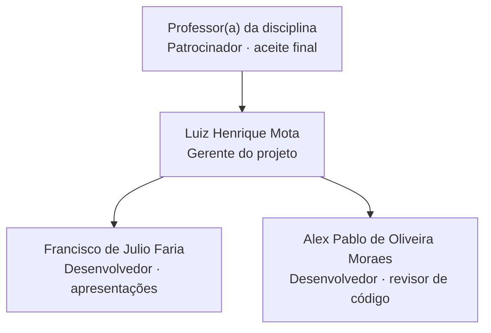

# Plano de Recursos Humanos

> **Processo PMBOK:** 9.1 Desenvolver o plano de recursos humanos
> **Área:** Gerenciamento dos Recursos Humanos · **Grupo:** Planejamento
> **Versão:** 1.0 · 29/10/2026

Define **quem** faz o quê no projeto, **com que autoridade**, **quando**
cada pessoa está disponível e **como** a equipe é mobilizada, desenvolvida
e gerenciada. É um plano auxiliar do
[Plano de Gerenciamento do Projeto](Plano-de-Gerenciamento-do-Projeto.md).
A execução deste plano está em:

- [Mobilização da Equipe](../03-Execucao/Mobilizacao-da-Equipe.md) — *9.2*
- [Desenvolvimento da Equipe](../03-Execucao/Desenvolvimento-da-Equipe.md) — *9.3*
- [Gerenciamento da Equipe](../03-Execucao/Gerenciamento-da-Equipe.md) — *9.4*

---

## 1. Contexto

| Item | Situação |
|------|----------|
| Tamanho da equipe | 3 integrantes (Termo de Abertura, §11) |
| Origem | Equipe formada na disciplina — **pré-designada**, sem contratação |
| Dedicação | **Parcial**: os integrantes cursam outras disciplinas |
| Custo de pessoal | R$ 0,00 — o recurso controlado é **hora da equipe** |
| Forma de trabalho | Remota pelo GitHub + reuniões semanais (presenciais ou on-line) |

Por ser um projeto acadêmico, não há contratação, folha de pagamento nem
desligamento formal. Os processos de RH se concentram em **distribuir bem o
trabalho**, **nivelar o conhecimento técnico** e **manter a equipe
engajada** até a entrega final.

## 2. Organograma do projeto

A estrutura é **projetizada e plana**: todos respondem ao gerente do
projeto, e os desenvolvedores revisam o código uns dos outros.

## 3. Papéis e responsabilidades

| Papel | Quem | Autoridade | Responsabilidades | Competências necessárias |
|-------|------|-----------|-------------------|--------------------------|
| **Patrocinador** | Professor(a) | Aceite final; decide mudanças de alto impacto | Avaliar entregas e apresentações | — |
| **Gerente do projeto (GP)** | Luiz | Prioriza o backlog; distribui pacotes; aprova merges e mudanças de baixo impacto | Planejar, acompanhar o progresso, conduzir reuniões e auditorias, remover impedimentos, manter `docs/gerenciamento/` | PMBOK, Git/GitHub, visão da arquitetura inteira |
| **Desenvolvedor(a)** | Francisco, Alex, Luiz | Decide a implementação dentro do pacote recebido | Implementar o pacote da EAP, escrever testes, abrir PR com a definição de pronto | Vue 3 + Pinia, Node/Express, Prisma, Vitest |
| **Revisor(a) de código** | Quem **não** é autor do PR (rodízio) | Aprova ou pede ajustes no PR | Aplicar o checklist de revisão (§5.2 do [plano da qualidade](Plano-de-Gerenciamento-da-Qualidade.md)) | Leitura do código das duas camadas |
| **Apresentador(a)** | Os três, por bloco de slides | — | Preparar e apresentar seu bloco no tempo combinado | Domínio do conteúdo do bloco |
| **Responsável pelo deploy** | Luiz (configuração) + equipe (contas) | Publica versões | Manter o sistema no ar, `JWT_SECRET` e senhas seguras | Docker, variáveis de ambiente |

## 4. Matriz de responsabilidades (RACI)

**R** = executa · **A** = aprova/presta contas (um por linha) · **C** = consultado · **I** = informado

| Pacote da EAP | Luiz (GP) | Francisco | Alex | Professor(a) |
|---------------|:---------:|:---------:|:----:|:------------:|
| 1.1 Fundação técnica (F0) | A/R | I | I | I |
| 1.2 Persistência e veículos (F1) | A | I | R | I |
| 1.3 Peças e acessórios (F2) | A | C | R | I |
| 1.4 Carrinho e checkout (F3) | A/R | I | I | I |
| 1.5 Serviços e agendamento (F4) | A/R | I | I | I |
| 1.6 Área administrativa (F5) | A/R | I | I | I |
| 1.7.1–1.7.2 Testes E2E e Lighthouse | A/R | I | I | I |
| 1.7.3 Deploy | A | R | R | I |
| 1.8.1–1.8.3 Artefatos PMBOK | A/R | C | R | I |
| 1.8.4 Apresentações | A | R | R | C |
| 1.8.5 Encerramento e lições aprendidas | A | R | R | I |
| Revisão de PRs (contínuo) | A | R | R | — |
| Aceite final do projeto | R | I | I | **A** |

> Nas fases F0–F6 a matriz registra o que **aconteceu** (ver
> [Mobilização da Equipe](../03-Execucao/Mobilizacao-da-Equipe.md), §3).
> Para o trabalho restante (1.7.3, 1.8.4, 1.8.5 e revisões), Francisco e
> Alex passam a ser **R** — é a principal correção deste plano.

## 5. Plano de gerenciamento de pessoal

### 5.1 Mobilização

- A equipe é **pré-designada** pela disciplina; não há seleção externa.
- Cada pacote da EAP é atribuído **na reunião semanal**, por
  **negociação**: o GP propõe, a pessoa aceita ou sugere troca.
- Critérios de atribuição: (1) disponibilidade na semana, (2) afinidade com
  a camada (frontend/backend/docs), (3) **distribuição equilibrada** —
  nenhum integrante deve ficar uma fase inteira sem pacote.
- Ao receber o primeiro pacote, o integrante precisa ter os acessos da §5.7.

### 5.2 Calendário de recursos

Disponibilidade **planejada** (estimativa da equipe; cada integrante
confirma ou corrige na reunião semanal):

| Integrante | Horas/semana | Melhores dias | Indisponível |
|-----------|:------------:|---------------|--------------|
| Luiz | 8 h | A combinar na reunião | Semanas de prova |
| Francisco | 6 h | A combinar na reunião | Semanas de prova |
| Alex | 6 h | A combinar na reunião | Semanas de prova |
| **Total** | **20 h** | | |

| Período | Capacidade | Observação |
|---------|:----------:|------------|
| 30/10 – 22/11 | 100% | Fechamento da F6 e artefatos PMBOK restantes |
| 23/11 – 06/12 | ~50% | Provas de outras disciplinas (estimado) |
| 07/12 – 13/12 | 100% | Deploy, encerramento e apresentação final |

### 5.3 Critérios de liberação

| Situação | O que acontece |
|----------|----------------|
| Pacote concluído | PR mergeado + status atualizado na EAP → integrante livre para outro pacote |
| Fim do projeto | Após o aceite do patrocinador e o registro de **lições aprendidas** (1.8.5) |
| Saída antecipada (trancamento, troca de turma) | GP redistribui os pacotes abertos; o integrante entrega o que está em andamento em uma branch e passa o contexto |
| Ao liberar | Remover acessos sensíveis (§5.7) que não forem mais necessários |

### 5.4 Necessidades de treinamento

| Lacuna | Quem precisa | Como treinar | Quando |
|--------|-------------|--------------|--------|
| Prisma (migrations, transações) | Francisco | Par com Alex em um pacote de backend | Até 15/11 |
| Fluxo PR + revisão no GitHub | Francisco, Alex | Revisar juntos um PR real usando o template | Próxima reunião |
| Playwright e testes E2E | Francisco, Alex | Rodar `npm run test:e2e` e ler os testes existentes | Até 15/11 |
| Deploy com Docker / Coolify | Equipe | Seguir `docs/DEPLOY.md` juntos | Antes do deploy (CR-10) |
| Conteúdo PMBOK do seu bloco | Apresentador(a) | Ler o artefato e ensaiar com o grupo | Semana da apresentação |

Material de apoio já existente: `README.md`, `plan.md`, `AGENTS.md`,
`docs/DEPLOY.md` e o template de PR.

### 5.5 Reconhecimento e recompensas

Sem recompensa financeira. O reconhecimento é:

- **Autoria visível** — cada entrega fica no histórico do Git, no log de
  execução e no `CHANGELOG.md`.
- **Crédito nas apresentações** — cada integrante apresenta o que construiu.
- **Registro no encerramento** — contribuição de cada um nas lições aprendidas.

### 5.6 Conformidade

- Seguir as regras da disciplina (prazos, apresentações, autoria).
- Código sob licença MIT; nada copiado de terceiros sem licença compatível.
- Dados do catálogo são fictícios; **nenhum dado pessoal real** no seed.

### 5.7 Acessos e segurança

| Acesso | Quem | Observação |
|--------|------|-----------|
| Colaborador no repositório GitHub | Os três | Necessário para abrir branch e revisar PR |
| `backend/.env` com credenciais do banco | Quem desenvolve backend | Compartilhado em particular, **nunca** no Git |
| Painel do Coolify / hospedagem | Luiz + responsável pelo deploy | Senha individual |
| `ADMIN_SENHA` e `JWT_SECRET` de produção | Responsável pelo deploy | Trocar se alguém deixar a equipe |

## 6. Riscos de recursos humanos

Complementam a §9 do plano de gerenciamento:

| ID | Risco | Prob. | Impacto | Resposta |
|----|-------|:-----:|:-------:|----------|
| R7 | Trabalho concentrado em uma pessoa (o GP) — se ela parar, o projeto para | Alta | Alto | **Mitigar:** distribuir pacotes (§4), revisão cruzada e par de programação |
| R8 | Dedicação parcial cai em semana de provas | Alta | Médio | **Aceitar/mitigar:** capacidade reduzida no calendário (§5.2); pacotes pequenos |
| R9 | Integrante sem acesso ou sem ambiente pronto não consegue contribuir | Média | Médio | **Evitar:** checklist de acessos (§5.7) e setup pelo README |
| R10 | Conflito sobre divisão de trabalho ou nota | Baixa | Médio | **Mitigar:** regras básicas e gestão de conflitos ([Gerenciamento da Equipe](../03-Execucao/Gerenciamento-da-Equipe.md)) |
