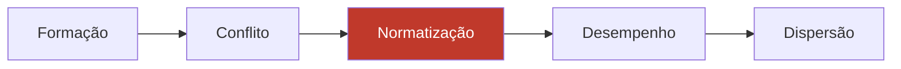

# Desenvolver a Equipe do Projeto

> **Processo PMBOK:** 9.3 Desenvolver a equipe do projeto
> **Área:** Gerenciamento dos Recursos Humanos · **Grupo:** Execução
> **Avaliação de desempenho da equipe nº 1** · data de corte: 29/10/2026

Melhora as **competências** dos integrantes e a **colaboração** entre eles
para aumentar o desempenho do projeto, conforme o
[Plano de Recursos Humanos](../02-Planejamento/Plano-de-Recursos-Humanos.md).

---

## 1. Objetivos de desenvolvimento

| # | Objetivo | Indicador | Meta |
|---|----------|-----------|------|
| D1 | Todos conseguem trabalhar nas duas camadas | Integrantes com PR mergeado em backend **e** frontend | 3 de 3 |
| D2 | Ninguém é ponto único de falha | Pacotes restantes com responsável diferente do GP | ≥ 50% |
| D3 | Revisão por pares de verdade | PRs com aprovação de outro integrante (M08) | 100% |
| D4 | Equipe se conhece e se comunica | Presença nas reuniões semanais | ≥ 80% |

## 2. Regras básicas (acordo da equipe)

1. Reunião semanal de até 30 min: o que fiz, o que vou fazer, o que me trava.
2. Quem pegou um pacote avisa no grupo se não vai conseguir entregar
   **antes** do prazo, não depois.
3. Responder pedido de revisão de PR em até **48 h**.
4. Crítica é ao código, não à pessoa; sugestão vem com o porquê.
5. Trabalho feito fora do Git (pesquisa, slides, testes manuais) também é
   registrado no log de execução.
6. Decisões técnicas que afetam outra pessoa são combinadas no grupo ou no PR.
7. Ninguém faz push direto na `main`.

## 3. Treinamento

| Ação | Participantes | Formato | Status |
|------|---------------|---------|:------:|
| Setup do ambiente seguindo o README (Docker + WSL) | Francisco, Alex | Sessão conjunta on-line | ⏳ |
| Tour pela arquitetura: rota → Prisma → serializer; `src/api` → store → view | Equipe | Luiz apresenta 30 min | ⏳ |
| Programação em par em um pacote de backend (AM-08 ou artefato do CI) | Francisco + Alex | Par | ⏳ |
| Revisão guiada de um PR com o checklist da qualidade | Equipe | Reunião | ⏳ |
| Ensaio da apresentação | Equipe | Reunião | Antes de cada apresentação |

## 4. Atividades de integração (*team building*)

| Atividade | Objetivo |
|-----------|----------|
| Ensaios conjuntos das apresentações | Já praticado nas duas apresentações — manter |
| Demonstração ao fim de cada pacote | Quem fez mostra ao grupo; reconhecimento e transferência de conhecimento |
| Retrospectiva curta (o que manter / o que mudar) | Uma por fase, alimentando as lições aprendidas |

## 5. Ferramentas de colaboração

| Necessidade | Ferramenta |
|------------|-----------|
| Código, revisão, histórico de autoria | GitHub (branches, PRs, issues) |
| Comunicação rápida | Grupo da equipe |
| Reuniões | Presencial na faculdade ou chamada de vídeo |
| Documentação compartilhada | `docs/gerenciamento/` no repositório |

## 6. Estágio de desenvolvimento da equipe (modelo de Tuckman)

| Estágio | Sinais no projeto |
|---------|-------------------|
| Formação (ago) | Equipe definida; Luiz faz a refatoração inicial sozinho |
| Conflito | Não houve conflito aberto; o risco é o oposto — trabalho concentrado sem discussão |
| **Normatização (atual)** | Regras escritas (`AGENTS.md`, definição de pronto, regras básicas acima), mas ainda **não praticadas** por todos |
| Desempenho (meta) | Pacotes distribuídos, revisão cruzada, cada um entrega sem depender do GP |
| Dispersão (dez) | Encerramento e lições aprendidas |

## 7. Avaliação de desempenho da equipe nº 1 — 29/10/2026

**Fontes:** `git shortlog`, PRs do GitHub, roteiros das apresentações,
[Garantia da Qualidade](Garantia-da-Qualidade.md) (auditoria nº 1).

| # | Indicador | Resultado | Situação |
|---|-----------|-----------|:--------:|
| DE-01 | Entregas no prazo | F0–F5 concluídas antes da linha de base do cronograma; F6 só com deploy pendente | ✅ |
| DE-02 | Qualidade técnica | CI 12/12 verde; 84 testes unitários e 10 E2E; Lighthouse ≥ 95 | ✅ |
| DE-03 | Apresentações | 2 de 2 feitas com os três apresentando seu bloco | ✅ |
| DE-04 | Distribuição do trabalho (D2) | 25 de 30 commits do GP; F3–F6 inteiras com um único autor | ❌ |
| DE-05 | Revisão por pares (D3) | 0 de 9 PRs com revisão registrada | ❌ |
| DE-06 | Competência nas duas camadas (D1) | 1 de 3 (Luiz). Alex: backend + frontend na F1/F2, sem PR próprio. Francisco: sem contribuição no código | ❌ |
| DE-07 | Reuniões semanais (D4) | Sem registro de presença até agora | ⚠️ |

Legenda: ✅ atende · ⚠️ sem dado / parcial · ❌ não atende

**Conclusão:** o **produto** está bom; a **equipe** ainda não. O projeto
depende de uma pessoa, e o conhecimento das fases F3–F6 não foi
compartilhado. As ações estão no log de questões do
[Gerenciamento da Equipe](Gerenciamento-da-Equipe.md) (RH-01 a RH-04).
Próxima avaliação: 22/11/2026, medindo de novo D1–D4.
