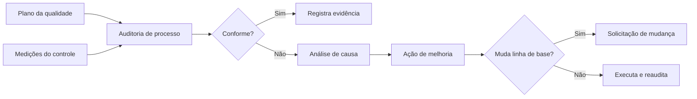

# Realizar a Garantia da Qualidade

> **Processo PMBOK:** 8.2 Realizar a garantia da qualidade
> **Área:** Gerenciamento da Qualidade · **Grupo:** Execução
> **Auditoria de qualidade nº 1** · data de corte: 22/10/2026

A garantia da qualidade verifica se os **processos** definidos no
[Plano de Gerenciamento da Qualidade](../02-Planejamento/Plano-de-Gerenciamento-da-Qualidade.md)
estão sendo **seguidos** e se são **eficazes**. O produto em si é medido no
[Controle da Qualidade](../04-Monitoramento-e-Controle/Controle-da-Qualidade.md).

---

## 1. Como a garantia é feita

| Técnica | Aplicação |
|---------|-----------|
| **Auditoria de qualidade** | Comparar o que o plano diz com o que o histórico do Git/GitHub mostra |
| **Análise de processos** | Medir onde o fluxo PR → CI → merge perde tempo ou deixa passar defeitos |
| **Análise de causa raiz** | Para cada não conformidade, perguntar "por quê?" até chegar a uma ação |
| **Reprodução do ambiente** | Subir o projeto do zero seguindo só o README |

**Frequência:** uma auditoria por fase ou antes de cada apresentação.

## 2. Auditoria nº 1 — 22/10/2026

**Escopo:** processos de configuração (§4 do plano de gerenciamento),
execução (regras de [Orientar e Gerenciar a Execução](Orientar-e-Gerenciar-Execucao.md))
e as métricas de processo M06–M09 e M11.
**Fontes:** `git log`, PRs e execuções do GitHub Actions, `npm audit`, setup
do zero em máquina nova (WSL + Docker).

### 2.1 Constatações

| # | Processo auditado | Evidência | Resultado |
|---|------------------|-----------|:---------:|
| AQ-01 | Todo merge via PR **revisado** por outro integrante (M08) | 8 PRs abertos, todos pelo mesmo autor; **0 de 8** com revisão registrada no GitHub. PRs #1, #7 e #8 entraram sem aprovação | ❌ |
| AQ-02 | `main` protegida; CI bloqueia merge | Proteção da branch **desativada** (`protected: false`). Na `main` há **12 commits diretos** e 3 merges de PR | ❌ |
| AQ-03 | Um pacote = uma branch = um PR | PRs #2–#6 (F3, F4, F5, F6 e correção do painel) continuam **abertos**, mas o conteúdo entrou pelo PR #7 "F0 a F6 (consolidado)" — um PR grande demais para revisão efetiva | ⚠️ |
| AQ-04 | Commits em Conventional Commits (M09) | 19 de 24 commits (79%). Os 5 fora do padrão são de 14/08 a 14/09, **antes** da regra; desde 12/10, 100% no padrão | ✅ |
| AQ-05 | CI roda lint, formatação, testes, build e E2E (M07) | 12 de 12 execuções com sucesso; os 3 jobs cobrem todas as etapas do plano | ✅ |
| AQ-06 | Duração do CI (M11) | Até 15/10: ~2 min. Em 22/10: **12 min 30 s**, sendo 11 min 49 s no job E2E (passo `playwright install --with-deps`) | ⚠️ |
| AQ-07 | Dependências verificadas (M06) | Não havia verificação no processo. `npm audit` em 22/10 achou, em produção: 1 **crítica** (`proxy-addr`, falsificação de IP — relevante porque a API usa `TRUST_PROXY`), 3 altas no Prisma (backend) e 3 altas no frontend (`vue` e dependências) | ❌ |
| AQ-08 | Cobertura de testes medida (M04) | Não havia ferramenta de cobertura configurada | ❌ |
| AQ-09 | Ambiente reproduzível pelo README | Setup do zero em 22/10: funcionou, mas faltava orientar o uso de WSL no Windows (`npm` não encontrado no PowerShell) | ⚠️ |

Legenda: ✅ conforme · ⚠️ conforme com observação · ❌ não conforme

### 2.2 Análise de causa

| # | Causa raiz |
|---|-----------|
| AQ-01, AQ-02 | A regra "PR revisado" existe só no papel: sem a proteção da branch, nada impede o merge sem revisão nem o push direto. A pressa da 2ª apresentação levou a consolidar tudo em um PR |
| AQ-03 | Os PRs por fase foram abertos em sequência (cada um sobre o anterior) e depois unificados; os originais não foram fechados |
| AQ-06 | O runner `ubuntu-latest` instala dependências de sistema do Chromium a cada execução; não há cache dos navegadores do Playwright |
| AQ-07, AQ-08 | Ferramentas não previstas no plano original (§7 do plano de gerenciamento) — o processo não tinha a etapa |
| AQ-09 | O README foi escrito em Linux; o caso Windows/WSL não foi testado |

## 3. Ações de melhoria

| # | Tipo | Ação | Constatação | Responsável | Status |
|---|------|------|:-----------:|-------------|:------:|
| AM-01 | Corretiva | Corrigir as vulnerabilidades sem quebra de versão (`npm audit fix`): `proxy-addr`, `qs`, `body-parser`, `express` e `vue`. Lint, 84 testes unitários, build e 10 E2E verdes depois | AQ-07 | Luiz | ✅ 22/10 |
| AM-02 | Preventiva | Adicionar `npm audit --omit=dev --audit-level=critical` ao CI (backend e frontend) | AQ-07 | Luiz | ✅ 22/10 |
| AM-03 | Preventiva | Configurar cobertura (`npm run test:coverage`) no backend e no frontend | AQ-08 | Luiz | ✅ 22/10 |
| AM-04 | Preventiva | Template de PR com a definição de pronto e o checklist de revisão (`.github/pull_request_template.md`) | AQ-01 | Luiz | ✅ 22/10 |
| AM-05 | Corretiva | README com setup via Docker e aviso de WSL no Windows | AQ-09 | Luiz | ✅ 22/10 (`5b06e21`) |
| AM-06 | Preventiva | **Ativar a proteção da `main`**: exigir PR, 1 aprovação e os checks `backend`, `frontend` e `e2e` | AQ-01, AQ-02 | Luiz (dono do repositório) | ⏳ |
| AM-07 | Corretiva | Fechar os PRs #2–#6 com comentário apontando para o #7 | AQ-03 | Luiz | ⏳ |
| AM-08 | Preventiva | Cache dos navegadores do Playwright no CI (`actions/cache` em `~/.cache/ms-playwright`) | AQ-06 | Equipe | ⏳ |
| AM-09 | Preventiva | Daqui em diante, PRs pequenos (um pacote da EAP cada) e revisados por Francisco ou Alex | AQ-01, AQ-03 | Equipe | Contínuo |

Ações que mudam versão major de dependência (Prisma 7, Vite 8, Vitest 5)
foram encaminhadas como solicitações de mudança — ver CR-11 e CR-12 no
[Controle Integrado de Mudanças](../04-Monitoramento-e-Controle/Controle-Integrado-de-Mudancas.md).

## 4. Resumo

| Situação | Qtd. |
|----------|:----:|
| Conformes | 2 |
| Conformes com observação | 3 |
| Não conformes | 4 |
| Ações concluídas na própria auditoria | 5 de 9 |

A maior lacuna é de **processo, não de produto**: o código está testado e
o CI funciona, mas a revisão por pares — o principal controle preventivo
do plano — ainda não acontece de fato. A ação AM-06 resolve isso na raiz.
Próxima auditoria: antes da entrega final (dezembro), conferindo AM-06 a AM-09.
