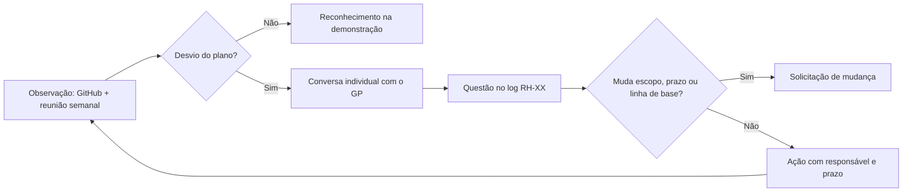

# Gerenciar a Equipe do Projeto

> **Processo PMBOK:** 9.4 Gerenciar a equipe do projeto
> **Área:** Gerenciamento dos Recursos Humanos · **Grupo:** Execução
> **Versão:** 1.0 · 29/10/2026

Acompanha o desempenho de cada integrante, dá retorno, resolve questões e
conflitos e coordena mudanças para melhorar o desempenho do projeto,
conforme o [Plano de Recursos Humanos](../02-Planejamento/Plano-de-Recursos-Humanos.md).

---

## 1. Como a equipe é gerenciada

| Técnica (PMBOK) | Aplicação |
|-----------------|-----------|
| **Observação e conversas** | GP acompanha PRs, commits e o andamento dos pacotes; pergunta na reunião semanal o que está travando |
| **Avaliações de desempenho** | Uma por fase ([Desenvolvimento da Equipe](Desenvolvimento-da-Equipe.md), §7) + retorno individual |
| **Gerenciamento de conflitos** | §3 deste documento |
| **Log de questões** | §4 deste documento |
| **Habilidades interpessoais** | Liderança servidora: o GP remove impedimentos e ensina em vez de fazer pelo outro |

## 2. Acompanhamento do desempenho individual

O retorno individual é feito **em conversa particular**, não neste
documento. Aqui fica só o que é objetivo e combinado:

| Integrante | Pacotes designados abertos | Entregues no ciclo | Revisões feitas | Retorno dado em |
|-----------|:--------------------------:|:------------------:|:---------------:|:---------------:|
| Luiz | AM-06 | — | — | — |
| Alex | 1.7.3 Deploy | — | 0 | ⏳ |
| Francisco | AM-08, 1.8.5 | — | 0 | ⏳ |

Atualizado a cada reunião semanal a partir da
[Mobilização da Equipe](Mobilizacao-da-Equipe.md), §4.

## 3. Gerenciamento de conflitos

| Fonte comum de conflito | Abordagem preferida | Exemplo no projeto |
|-------------------------|---------------------|--------------------|
| Divisão de trabalho / crédito | **Colaborar** (resolver o problema juntos) | Redistribuir pacotes em reunião, com registro na EAP |
| Decisão técnica | **Colaborar**; se travar, o GP decide (**forçar**) com base no `AGENTS.md` | Escolha de biblioteca, estrutura de pasta |
| Prioridade entre pacotes | **Conciliar** (cada lado cede um pouco) | Deploy antes de mais um artefato PMBOK |
| Prazo vs. outras disciplinas | **Acomodar** temporariamente + replanejar | Semana de provas: pacote passa para outra pessoa |
| Divergência que persiste | **Escalar** ao patrocinador (professor/a) | Só se a equipe não chegar a acordo |

Regras: conflito é tratado **cedo**, **em particular** e **sobre fatos**
(PR, prazo, pacote), nunca sobre a pessoa. Evitar o conflito não é
resolvê-lo — o silêncio sobre a divisão de trabalho é o principal risco
atual (R7).

## 4. Log de questões da equipe

| # | Questão | Origem | Impacto | Ação | Responsável | Prazo | Status |
|---|---------|--------|:-------:|------|-------------|:-----:|:------:|
| RH-01 | Trabalho de F3–F6 concentrado no GP; Francisco sem pacote de código atribuído no dicionário da EAP | DE-04, DE-06 | Alto (R7) | Redistribuir o trabalho restante ([Mobilização](Mobilizacao-da-Equipe.md), §4) e atualizar a EAP | Luiz | 30/10 | ⏳ |
| RH-02 | Nenhum PR revisado por outro integrante | DE-05, AQ-01 | Alto | Proteção da `main` exigindo 1 aprovação (AM-06) + rodízio de revisores Francisco/Alex | Luiz | 31/10 | ⏳ |
| RH-03 | Acessos e ambiente local de Francisco não confirmados | Mobilização §5 | Médio (R9) | Sessão de setup pelo README; conceder colaborador no GitHub e `.env` | Luiz + Francisco | 05/11 | ⏳ |
| RH-04 | Sem registro de reuniões nem de trabalho feito fora do Git | DE-07 | Médio | Ata curta (3 linhas) de cada reunião em issue do GitHub com o rótulo `reuniao` | Alex | 06/11 | ⏳ |
| RH-05 | Capacidade reduzida em semana de provas (23/11 – 06/12) | Calendário de recursos | Médio (R8) | Antecipar deploy para antes de 22/11; pacotes pequenos no período | Equipe | 22/11 | ⏳ |

Legenda: ✅ resolvida · ⏳ em andamento · ❌ não resolvida no prazo

## 5. Mudanças e atualizações geradas

| Item | Tipo | Encaminhamento |
|------|------|----------------|
| Troca de responsáveis nos pacotes restantes | Atualização da EAP (sem mudança de escopo, prazo ou custo) | Aprovada pelo GP — não precisa de solicitação de mudança |
| Exigir aprovação de outro integrante para merge | Mudança de processo | Já registrada como AM-06 na [Garantia da Qualidade](Garantia-da-Qualidade.md) |
| Riscos R7–R10 | Atualização do registro de riscos | Incluídos no [Plano de Recursos Humanos](../02-Planejamento/Plano-de-Recursos-Humanos.md), §6 |
| Se o deploy (1.7.3) não sair até 22/11 | Possível mudança de cronograma | Abrir solicitação de mudança no [Controle Integrado de Mudanças](../04-Monitoramento-e-Controle/Controle-Integrado-de-Mudancas.md) |

## 6. Lições aprendidas até agora

- Planejar **quem** faz cada pacote é tão importante quanto planejar
  **o quê**: o dicionário da EAP com "Equipe" ou sem responsável deixou o
  trabalho cair em quem tinha mais contexto.
- Fazer pelo outro é mais rápido na semana, mas cria dependência no
  projeto — e prejudica o aprendizado de quem ficou de fora.
- Regra que não é verificada por ferramenta (revisão por pares) não acontece
  sob pressão de prazo.
