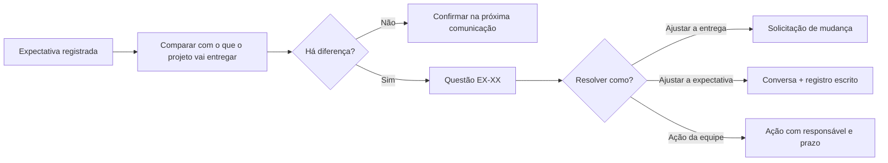

# Gerenciar as Expectativas das Partes Interessadas

> **Processo PMBOK:** 10.4 Gerenciar as expectativas das partes interessadas
> **Área:** Gerenciamento das Comunicações · **Grupo:** Execução
> **Versão:** 1.0 · 29/10/2026

Trabalha com as partes interessadas para **atender às necessidades** delas
e **tratar as questões** assim que surgem, aumentando o apoio ao projeto e
reduzindo resistências. Usa o [Registro das Partes Interessadas](../01-Iniciacao/Registro-das-Partes-Interessadas.md)
e o [Plano de Gerenciamento das Comunicações](../02-Planejamento/Plano-de-Gerenciamento-das-Comunicacoes.md).

---

## 1. Como as expectativas são gerenciadas

| Técnica (PMBOK) | Aplicação |
|-----------------|-----------|
| **Métodos de comunicação** | Matriz C01–C11 do plano das comunicações |
| **Habilidades interpessoais** | Ouvir antes de propor; deixar claro o que **não** será entregue (exclusões do escopo) |
| **Habilidades de gerenciamento** | Negociar prazo e escopo com o patrocinador; apresentar com dados |
| **Log de questões** | §3 deste documento |

## 2. Expectativas × situação atual

| Parte interessada | Expectativa | O que o projeto entrega | Alinhado? |
|-------------------|-------------|-------------------------|:---------:|
| PI-01 Professor(a) | Artefatos PMBOK aplicados ao projeto real | Integração, Escopo, Qualidade, RH e Comunicações documentados com evidências do repositório | ✅ |
| PI-01 Professor(a) | Sistema publicado em URL pública (critério do Termo de Abertura) | Tudo pronto para publicar, **ainda não publicado** (1.7.3, CR-10) | ⚠️ |
| PI-01 Professor(a) | Trabalho de equipe (os três contribuindo) | Contribuição no código concentrada no GP | ❌ |
| PI-02 Banca | Demonstração do sistema funcionando | Demonstração local possível; pública depende do deploy | ⚠️ |
| PI-04 Alex | Aprender na prática e ser reconhecido | Fez F1/F2; sem pacote desde 10/09 | ⚠️ |
| PI-05 Francisco | Contribuição reconhecida | Apresentou a abertura 2×; sem acesso ao repositório | ❌ |
| PI-06 Chiquinho Motors | Pagamento on-line no checkout | **Fora do escopo** — o pedido gera contato (restrição do Termo de Abertura) | ✅ comunicado |
| PI-07 Admin da loja | Gerenciar tudo pelo painel | Painel completo (F5) | ✅ |
| PI-08 Clientes finais | Site rápido e acessível no celular | Lighthouse 95–100; E2E em celular | ✅ |

## 3. Log de questões das partes interessadas

| # | Questão | Parte interessada | Ação | Responsável | Prazo | Status |
|---|---------|-------------------|------|-------------|:-----:|:------:|
| EX-01 | Sistema ainda não está em URL pública, que é critério de sucesso | PI-01, PI-02 | Decidir CR-10 e publicar seguindo `docs/DEPLOY.md` | Alex (Luiz apoia) | 22/11 | ⏳ |
| EX-02 | Professor(a) espera trabalho de equipe; o histórico mostra um autor principal | PI-01 | Redistribuição do trabalho (RH-01) e relatório honesto sobre o tema no próximo status | Luiz | 22/11 | ⏳ |
| EX-03 | Francisco fora dos canais do GitHub | PI-05 | Convidar como colaborador; setup pelo README (RH-03) | Luiz | 05/11 | ⏳ |
| EX-04 | Banca pode esperar pagamento on-line ou integrações reais | PI-02, PI-06 | Mostrar na apresentação o que está **fora do escopo** e por quê (custo zero, sem gateway) | Apresentador(a) do escopo | Apresentação final | ⏳ |
| EX-05 | Risco de demonstração falhar ao vivo (rede, banco) | PI-02 | Ter o sistema publicado **e** um ambiente local de reserva com Docker | Equipe | Apresentação final | ⏳ |

Legenda: ✅ resolvida · ⏳ em andamento · ❌ não resolvida no prazo

## 4. Atualizações geradas

| Documento | Atualização |
|-----------|-------------|
| [Registro das Partes Interessadas](../01-Iniciacao/Registro-das-Partes-Interessadas.md) | Engajamento de PI-04 e PI-05 revisto a cada fase |
| [Controle Integrado de Mudanças](../04-Monitoramento-e-Controle/Controle-Integrado-de-Mudancas.md) | CR-10 precisa de decisão para destravar EX-01 |
| [Gerenciamento da Equipe](Gerenciamento-da-Equipe.md) | EX-02 e EX-03 ligadas a RH-01 e RH-03 |
