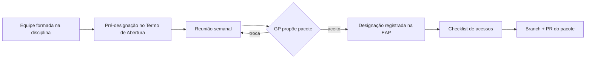

# Contratar ou Mobilizar a Equipe do Projeto

> **Processo PMBOK:** 9.2 Contratar ou mobilizar a equipe do projeto
> **Área:** Gerenciamento dos Recursos Humanos · **Grupo:** Execução
> **Versão:** 1.0 · 29/10/2026

Confirma **quem está disponível** e **designa** cada pessoa aos pacotes da
EAP, conforme o [Plano de Recursos Humanos](../02-Planejamento/Plano-de-Recursos-Humanos.md).

---

## 1. Como a equipe foi mobilizada

| Técnica (PMBOK) | Aplicação no projeto |
|-----------------|----------------------|
| **Pré-designação** | Os três integrantes já estavam definidos no [Termo de Abertura](../01-Iniciacao/Termo-de-Abertura.md) (§11) |
| **Negociação** | Distribuição de pacotes na reunião semanal, conforme disponibilidade e afinidade |
| **Contratação** | Não se aplica — custo zero, sem recursos externos |
| **Equipes virtuais** | Trabalho assíncrono pelo GitHub (branches, PRs, issues) + grupo da equipe |

## 2. Designações de pessoal

| Integrante | Papel designado | Data | Origem |
|-----------|-----------------|------|--------|
| Luiz Henrique Mota | Gerente do projeto · dono do repositório | 14/08/2026 | Termo de Abertura |
| Alex Pablo de Oliveira Moraes | Desenvolvedor · revisor de código | 14/08/2026 | Termo de Abertura |
| Francisco de Julio Faria | Desenvolvedor | 14/08/2026 | Termo de Abertura |

## 3. Designações realizadas até agora (F0–F6)

Levantado do histórico do Git e dos roteiros de apresentação
(data de corte: 29/10/2026).

| Fase / pacote | Planejado (dicionário da EAP) | Executado (evidência) |
|---------------|-------------------------------|------------------------|
| F0 — 1.1 Fundação técnica | Equipe | Luiz |
| F1 — 1.2.1–1.2.3 PostgreSQL, Prisma, API de veículos | Alex | Alex (`cb14f25`) |
| F1 — 1.2.4 Imagens locais | — | Alex (`69f8e5a`) |
| F2 — 1.3.1–1.3.2 Modelagem e API de catálogo | Alex | Alex (`cb14f25`) |
| F2 — 1.3.3 Telas de catálogo | Alex / Francisco | Alex (`72f8ffd`) |
| F3 — 1.4 Carrinho e checkout | Luiz | Luiz |
| F4 — 1.5 Serviços e agendamento | Luiz | Luiz |
| F5 — 1.6 Área administrativa | Luiz | Luiz |
| F6 — 1.7.1–1.7.2, 1.7.4 E2E, Lighthouse, README | — | Luiz |
| 1.8.2 Plano de implementação | — | Alex (`7509a96`) |
| 1.8.1–1.8.3 Artefatos PMBOK | — | Luiz |
| 1.8.4 1ª apresentação | Equipe | Francisco (P1), Luiz (P2), Alex (P3) |
| 1.8.4 2ª apresentação | Equipe | Francisco (slides 1–4), Luiz (5–8), Alex (9–14) |

**Distribuição de commits** (`git shortlog`, todas as branches):

| Integrante | Commits | Período |
|-----------|:-------:|---------|
| Luiz | 25 | 14/08 – 22/10 |
| Alex | 5 | 27/08 – 10/09 |
| Francisco | 0 | — |

> Commits medem só a contribuição **no repositório**. Francisco apresentou
> a abertura nas duas apresentações; trabalho fora do Git (pesquisa,
> ensaio, revisão de slides) deve ser registrado no log de execução para
> aparecer nesta tabela.

**Leitura:** a partir de setembro, as fases F3–F6 foram executadas por uma
só pessoa. O dicionário da EAP só previa Francisco em um pacote
compartilhado (1.3.3) — a falha começou no **planejamento das
designações**, não só na execução. Isso é tratado como questão RH-01 em
[Gerenciamento da Equipe](Gerenciamento-da-Equipe.md).

## 4. Designações para o trabalho restante

Proposta do GP para a reunião de 30/10/2026 (cada integrante confirma
ou negocia):

| Pacote / ação | Responsável | Apoio | Prazo |
|---------------|-------------|-------|-------|
| 1.7.3 Deploy — criar contas e publicar (CR-10) | Alex | Luiz | 22/11 |
| AM-08 Cache do Playwright no CI | Francisco | Alex (revisão) | 15/11 |
| AM-06 Ativar proteção da `main` | Luiz (dono do repositório) | — | 31/10 |
| Revisão de PRs (rodízio) | Francisco e Alex | — | Contínuo |
| Artefatos PMBOK restantes (cronograma, custos, comunicações, riscos) | Dividido entre os três | Luiz (revisão) | 22/11 |
| 1.8.4 Apresentação final | Os três, por bloco | — | 12/2026 |
| 1.8.5 Lições aprendidas | Francisco | Os três | 13/12 |

## 5. Calendário de recursos e acessos

| Integrante | Disponibilidade confirmada | Colaborador no GitHub | `.env` do banco | Ambiente local rodando |
|-----------|:--------------------------:|:---------------------:|:---------------:|:----------------------:|
| Luiz | ⏳ | ✅ (dono) | ✅ | ✅ |
| Alex | ⏳ | ✅ (commits na `main`) | ✅ (fez a migração F1) | ⏳ |
| Francisco | ⏳ | ⏳ | ⏳ | ⏳ |

Legenda: ✅ confirmado · ⏳ a confirmar na reunião de 30/10

O que estiver ⏳ ao fim da reunião vira ação no log de questões.

## 6. Atualizações em outros documentos

- **Dicionário da EAP:** coluna "Responsável" passa a refletir a §4 depois
  da confirmação.
- **Plano de Recursos Humanos:** calendário (§5.2) atualizado com as horas
  confirmadas.
