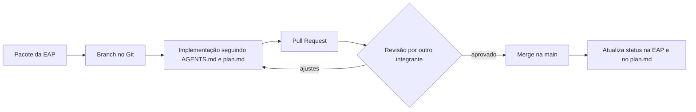

# Orientar e Gerenciar a Execução do Projeto

> **Processo PMBOK:** 4.3 Orientar e gerenciar o trabalho do projeto
> **Área:** Gerenciamento da Integração · **Grupo:** Execução
> **Versão:** 1.0 · 12/10/2026

---

## 1. Como o trabalho é executado

**Regras de execução**

1. Todo trabalho nasce de um **pacote da EAP** (ou de uma mudança aprovada).
2. Um pacote = uma branch = um Pull Request.
3. O código segue as convenções do `AGENTS.md` e do `plan.md`
   (rotas finas → Prisma → serializer; chamadas via `src/api`; ícones Lucide).
4. Mudanças no banco **somente** por migration do Prisma.
5. Ao concluir, o responsável marca o checklist da fase no `plan.md`.

## 2. Registro de entregas realizadas (log de trabalho)

| Data | Commit | Responsável | Entrega | Pacote EAP |
|------|--------|-------------|---------|-----------|
| 14/08/2026 | `14c6365` | Luiz | Refatoração para Vue 3 + Node.js com responsividade | 1.1.1 |
| 14/08/2026 | `4a9f2b2` | Luiz | Tema "Carbon & Racing Red" | 1.1.4 |
| 20/08/2026 | `e862de6`, `e7cf869` | Luiz | Ciclo de vida e plano de implementação | 1.8.2 |
| 27/08/2026 | `66ee733` | Luiz | `AGENTS.md`, skill de workflow, estrutura `docs/gerenciamento` | 1.8.2 |
| 27/08/2026 | `69f8e5a` | Alex | Imagens locais de veículos e produtos | 1.2.4 |
| 27/08/2026 | `cb14f25` | Alex | Migração para PostgreSQL + Prisma; API de peças/acessórios | 1.2.1–1.2.3, 1.3.1–1.3.2 |
| 27/08/2026 | `72f8ffd` | Alex | Telas de peças e acessórios com Pinia e Lucide | 1.3.3 |
| 27/08/2026 | `5d7b885` | Alex | README atualizado (PostgreSQL, endpoints) | 1.8.2 |
| 10/09/2026 | `7509a96` | Alex | Plano de implementação das entregas pendentes | 1.8.2 |
| 14/09/2026 | `05ec8f0` | Luiz | Roteiro e slides da 1ª apresentação | 1.8.4 |
| 25/09/2026 | *(em andamento)* | Luiz | Autenticação admin: modelo `Administrador`, login JWT, store `auth`, telas de login e dashboard | 1.6.1, 1.6.4 |
| 12/10/2026 | *(este pacote)* | Luiz | Artefatos de Integração e Escopo (PMBOK) | 1.8.1–1.8.3 |

## 3. Produtos entregues até agora

- **10 endpoints REST** funcionando (carros, peças, acessórios, categorias, modelos, contato).
- **3 migrations** aplicadas (`init`, `pecas_acessorios`, `auth_admin`).
- Banco com **9 modelos** relacionais (Marca, Carro, CarroImagem, ModeloVeiculo,
  Categoria, Produto, ProdutoCompatibilidade, MensagemContato, Administrador).
- Telas públicas: Home, Carros, Detalhe do carro, Peças, Acessórios,
  Detalhe do produto, Contato, Sobre, Dicas, Notícias, 404.
- Telas admin: Login e Dashboard (inicial).

## 4. Problemas registrados durante a execução (issue log)

| # | Problema | Impacto | Ação tomada | Status |
|---|----------|---------|-------------|:------:|
| I1 | Prisma apontando para porta 5432 (MariaDB) → erro de SSL | Bloqueou F1 | Banco correto na porta **5433** documentado no `plan.md` | ✅ |
| I2 | Imagens externas (OLX) retornando 403 por hotlink | Fotos quebradas | Imagens baixadas para `frontend/public/` (CR-03) | ✅ |
| I3 | `npm audit` com 3 "high" em `deepmerge-ts` | Baixo (só CLI do Prisma) | Registrado como dívida técnica | 🟡 |
| I4 | `JWT_SECRET` com valor padrão no código e senha seed `admin123` | Risco R4 em produção | Exigir variável de ambiente e trocar senha antes do deploy (F6) | ⬜ |
| I5 | Footer com "© 2023" e contatos pessoais no código | Baixo | Registrado como dívida técnica | ⬜ |

## 5. Solicitações de mudança geradas na execução

Toda mudança identificada aqui é registrada e analisada em
[Controle Integrado de Mudanças](../04-Monitoramento-e-Controle/Controle-Integrado-de-Mudancas.md).
