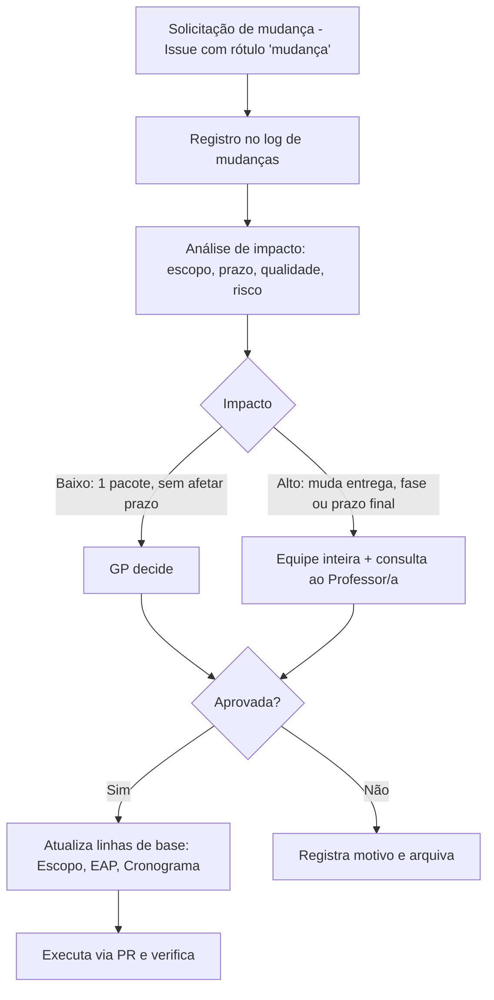

# Realizar o Controle Integrado de Mudanças

> **Processo PMBOK:** 4.6 Realizar o controle integrado de mudanças
> **Área:** Gerenciamento da Integração · **Grupo:** Monitoramento e Controle
> **Versão:** 1.0 · 12/10/2026

---

## 1. Fluxo de mudança



## 2. Comitê de controle de mudanças (CCM)

| Membro | Papel no CCM |
|--------|-------------|
| Luiz Henrique Mota | Gerente do projeto — decide mudanças de baixo impacto |
| Francisco de Julio Faria | Membro — analisa impacto técnico |
| Alex Pablo de Oliveira Moraes | Membro — analisa impacto técnico |
| Professor(a) da disciplina | Patrocinador — consultado em mudanças de alto impacto |

## 3. Formulário de solicitação de mudança

```markdown
**ID:** CR-XX            **Data:**            **Solicitante:**
**Descrição da mudança:**
**Justificativa:**
**Impacto no escopo (pacotes da EAP afetados):**
**Impacto no cronograma:**
**Impacto na qualidade / riscos:**
**Alternativas consideradas:**
**Decisão:** Aprovada / Rejeitada / Adiada     **Por:**     **Data:**
```

## 4. Log de mudanças

| ID | Data | Mudança | Justificativa | Impacto | Decisão |
|----|------|---------|---------------|---------|:-------:|
| CR-01 | 21/08/2026 | Substituir o mock em memória (`backend/data/`) por **PostgreSQL + Prisma** | Requisito de banco relacional e integridade | Alto — nova fase F1, novas migrations | ✅ Aprovada |
| CR-02 | 27/08/2026 | **Unificar peça e acessório** em um único modelo `Produto` (enum `TipoProduto`) em vez de duas tabelas | Mesmos atributos e mesmo fluxo de compra; menos código duplicado | Baixo — simplifica 1.3.1 e 1.3.2 | ✅ Aprovada |
| CR-03 | 27/08/2026 | Servir imagens **localmente** em vez de linkar sites externos | Hotlink bloqueado (403) pela OLX | Baixo — pacote 1.2.4 | ✅ Aprovada |
| CR-04 | 27/08/2026 | Retirar **Swagger/OpenAPI** da F2 e mover para dívida técnica | Priorizar entrega funcional da F2 no prazo | Baixo — reduz escopo da F2 | ✅ Aprovada |
| CR-05 | 25/09/2026 | **Antecipar a autenticação admin (F5)** antes de F3/F4 | Telas futuras de pedidos e agenda dependem de rotas protegidas; equipe com disponibilidade | Médio — altera sequência; não altera prazo final | ✅ Aprovada com condições ¹ |
| CR-06 | 25/09/2026 | Modelo `Administrador` (com campo `ativo`) no lugar de `Usuario` + enum `PapelUsuario` previsto no plano | Escopo só prevê um papel (admin); exclusão "múltiplos papéis" | Baixo — pacote 1.6.1 | ✅ Aprovada |
| CR-07 | 12/10/2026 | Contingência: se o prazo apertar, entregar **F4 como protótipo de tela** e usar **Prisma Studio** no lugar do CRUD completo da F5 | Risco R1 (prazo do semestre) | Alto — reduz escopo de E5 e E6 | ⛔ Encerrada sem uso — F4 e F5 entregues completas em 12/10 |
| CR-08 | 12/10/2026 | Agenda: grade de horários de cada serviço avança pela **duração do serviço** (08:00, 09:00… para 60 min) em vez de slots fixos de 30 min; fuso fixo de Sinop–MT (UTC-4) | Com slots de 30 min, a trava `@@unique([servicoId, dataHora])` permitiria sobreposição (60 min às 08:00 + outro às 08:30) | Baixo — pacotes 1.5.1–1.5.3, sem efeito no prazo | ✅ Aprovada ² |
| CR-09 | 12/10/2026 | Painel: rotas de status em `/api/admin/pedidos/:codigo/status` e `/api/admin/agendamentos/:codigo/status` (o plano previa `/api/pedidos/...`); uploads gravados em `backend/uploads` em vez de `frontend/public/uploads` | Um só prefixo protegido para o painel; backend não escreve na pasta do frontend | Baixo — pacotes 1.6.2 e 1.6.3 | ✅ Aprovada ³ |
| CR-10 | 12/10/2026 | Hospedar API e site no **Coolify** (Docker), onde o banco já está, em vez de Vercel + Railway/Render | Volume persistente para as fotos do painel sem custo extra; sem *cold start*; um só painel. `vercel.json` mantido como alternativa | Baixo — pacote 1.7.3, sem efeito no prazo | ⏳ Proposta — decisão do GP ⁴ |
| CR-11 | 22/10/2026 | Migrar **Prisma 6 → 7** (`prisma.config.ts` no lugar de `package.json#prisma`) | 3 vulnerabilidades altas em `deepmerge-ts` (CLI do Prisma) só se resolvem no 7; o aviso de *deprecated* já aparece | Médio — major version; pode exigir ajustes no schema e nos scripts; regressão coberta pelos 64 testes de API | ⏳ Proposta — após a apresentação ⁵ |
| CR-12 | 22/10/2026 | Atualizar **Vite 5 → 8** e **Vitest 2 → 5** no frontend | Vulnerabilidades críticas/altas no servidor de desenvolvimento e no runner de testes (não afetam o site publicado) | Médio — majors de build e teste; `@vitejs/plugin-vue` e configs mudam junto | ⏳ Proposta — após a apresentação ⁵ |

¹ **Condições do CR-05:** (a) a F3 continua sendo a próxima prioridade de
produto; (b) o trabalho de autenticação entra na `main` via PR revisado;
(c) o *fallback* de `JWT_SECRET` e a senha padrão do seed são corrigidos
antes do deploy (risco R4).

² **Limitação do CR-08 (resolvida na F5):** a trava passou para
`@@unique([servicoId, horarioAtivo])`; `horarioAtivo` vira NULL ao cancelar,
liberando o horário sem apagar o histórico.

³ **CR-09:** o painel concentra tudo sob `/api/admin/*` (um único ponto de
proteção por JWT) e as imagens ficam no backend (`backend/uploads`, servidas
em `/uploads`), respeitando a separação frontend/backend do `AGENTS.md`.

⁴ **CR-10:** as duas opções estão documentadas em `docs/DEPLOY.md`; a escolha
depende de quem tem acesso a cada conta.

⁵ **CR-11 e CR-12:** originados no [Controle da Qualidade](Controle-da-Qualidade.md)
(ações AC-03 e AC-04). As correções sem quebra de versão já foram aplicadas
em 22/10; estas ficam para depois da apresentação para não arriscar
regressão às vésperas.

## 5. Linhas de base atualizadas por mudanças

| Mudança | Documento atualizado |
|---------|---------------------|
| CR-01, CR-02 | EAP (1.2, 1.3), Plano de gerenciamento (§1) |
| CR-04 | Declaração de Escopo (§4 Exclusões) |
| CR-05 | Monitoramento (situação F5), Cronograma |
| CR-06 | EAP (1.6.1), Dicionário da EAP |
| CR-08 | Controlar o Escopo (análise de variação), `plan.md` (F4) |
| CR-09 | `plan.md` (F5), README (endpoints) |
| CR-10 | `plan.md` (F6), `docs/DEPLOY.md` |
| CR-11, CR-12 | `plan.md` (dívidas técnicas), Controle da Qualidade (§5) |
