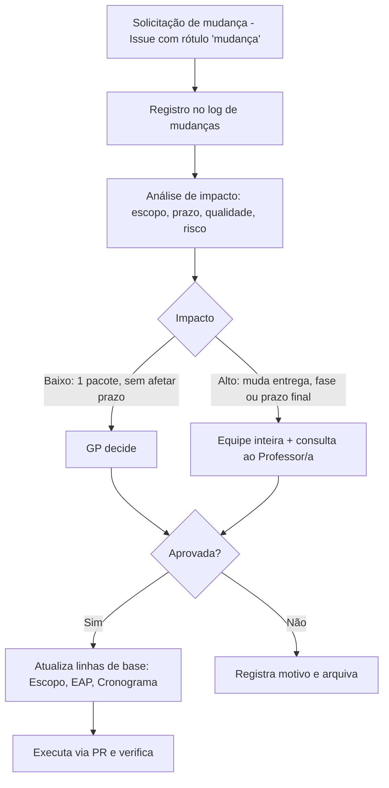

# Realizar o Controle Integrado de Mudanças

> **Processo PMBOK:** 4.6 Realizar o controle integrado de mudanças
> **Área:** Gerenciamento da Integração · **Grupo:** Monitoramento e Controle
> **Versão:** 1.0 · 12/10/2026

---

## 1. Fluxo de mudança



## 2. Comitê de controle de mudanças (CCM)

| Membro | Papel no CCM |
|--------|-------------|
| Luiz Henrique Mota | Gerente do projeto — decide mudanças de baixo impacto |
| Francisco de Julio Faria | Membro — analisa impacto técnico |
| Alex Pablo de Oliveira Moraes | Membro — analisa impacto técnico |
| Professor(a) da disciplina | Patrocinador — consultado em mudanças de alto impacto |

## 3. Formulário de solicitação de mudança

```markdown
**ID:** CR-XX            **Data:**            **Solicitante:**
**Descrição da mudança:**
**Justificativa:**
**Impacto no escopo (pacotes da EAP afetados):**
**Impacto no cronograma:**
**Impacto na qualidade / riscos:**
**Alternativas consideradas:**
**Decisão:** Aprovada / Rejeitada / Adiada     **Por:**     **Data:**
```

## 4. Log de mudanças

| ID | Data | Mudança | Justificativa | Impacto | Decisão |
|----|------|---------|---------------|---------|:-------:|
| CR-01 | 21/08/2026 | Substituir o mock em memória (`backend/data/`) por **PostgreSQL + Prisma** | Requisito de banco relacional e integridade | Alto — nova fase F1, novas migrations | ✅ Aprovada |
| CR-02 | 27/08/2026 | **Unificar peça e acessório** em um único modelo `Produto` (enum `TipoProduto`) em vez de duas tabelas | Mesmos atributos e mesmo fluxo de compra; menos código duplicado | Baixo — simplifica 1.3.1 e 1.3.2 | ✅ Aprovada |
| CR-03 | 27/08/2026 | Servir imagens **localmente** em vez de linkar sites externos | Hotlink bloqueado (403) pela OLX | Baixo — pacote 1.2.4 | ✅ Aprovada |
| CR-04 | 27/08/2026 | Retirar **Swagger/OpenAPI** da F2 e mover para dívida técnica | Priorizar entrega funcional da F2 no prazo | Baixo — reduz escopo da F2 | ✅ Aprovada |
| CR-05 | 25/09/2026 | **Antecipar a autenticação admin (F5)** antes de F3/F4 | Telas futuras de pedidos e agenda dependem de rotas protegidas; equipe com disponibilidade | Médio — altera sequência; não altera prazo final | ✅ Aprovada com condições ¹ |
| CR-06 | 25/09/2026 | Modelo `Administrador` (com campo `ativo`) no lugar de `Usuario` + enum `PapelUsuario` previsto no plano | Escopo só prevê um papel (admin); exclusão "múltiplos papéis" | Baixo — pacote 1.6.1 | ✅ Aprovada |
| CR-07 | 12/10/2026 | Contingência: se o prazo apertar, entregar **F4 como protótipo de tela** e usar **Prisma Studio** no lugar do CRUD completo da F5 | Risco R1 (prazo do semestre) | Alto — reduz escopo de E5 e E6 | ⏸ Adiada — decidir em 08/11 |

¹ **Condições do CR-05:** (a) a F3 continua sendo a próxima prioridade de
produto; (b) o trabalho de autenticação entra na `main` via PR revisado;
(c) o *fallback* de `JWT_SECRET` e a senha padrão do seed são corrigidos
antes do deploy (risco R4).

## 5. Linhas de base atualizadas por mudanças

| Mudança | Documento atualizado |
|---------|---------------------|
| CR-01, CR-02 | EAP (1.2, 1.3), Plano de gerenciamento (§1) |
| CR-04 | Declaração de Escopo (§4 Exclusões) |
| CR-05 | Monitoramento (situação F5), Cronograma |
| CR-06 | EAP (1.6.1), Dicionário da EAP |
