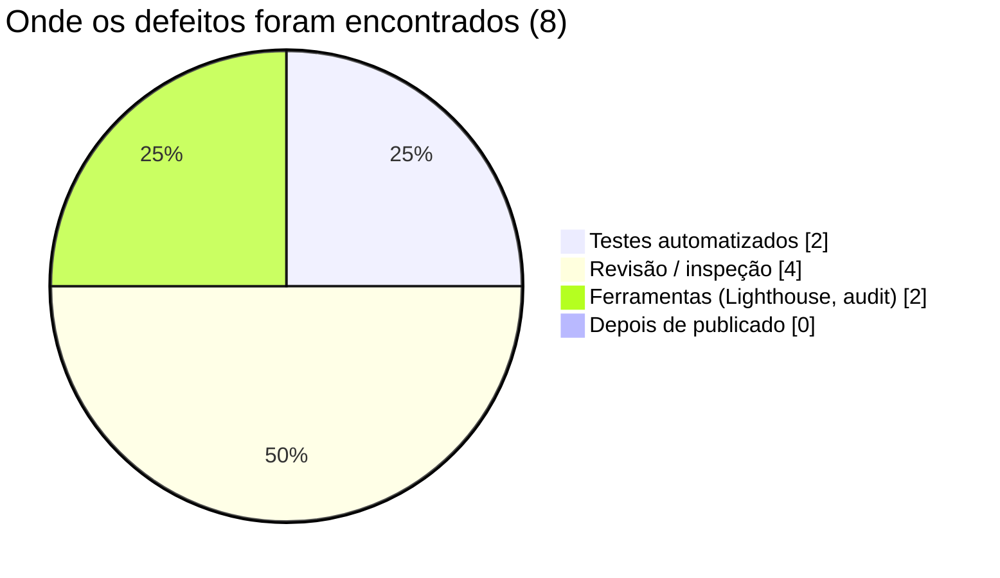

# Realizar o Controle da Qualidade

> **Processo PMBOK:** 8.3 Realizar o controle da qualidade
> **Área:** Gerenciamento da Qualidade · **Grupo:** Monitoramento e Controle
> **Relatório de qualidade nº 1** · data de corte: 22/10/2026

O controle da qualidade **mede o produto** e compara o resultado com as
metas do [Plano de Gerenciamento da Qualidade](../02-Planejamento/Plano-de-Gerenciamento-da-Qualidade.md).
Os processos são auditados na [Garantia da Qualidade](../03-Execucao/Garantia-da-Qualidade.md).

---

## 1. Como as medições são feitas

Todas as medições abaixo são reproduzíveis com os comandos do README
(banco de teste isolado na porta 55432):

```bash
cd backend  && npm run lint && npm run format:check && npm run test:coverage
cd frontend && npm run lint && npm run format:check && npm run test:coverage && npm run build
cd e2e      && npm test
npm audit --omit=dev            # em backend/ e frontend/
```

## 2. Painel de métricas

| ID | Métrica | Meta | Medido em 22/10/2026 | Status |
|----|---------|------|----------------------|:------:|
| M01 | Testes passando | 100% | **94 / 94** (64 API + 20 frontend + 10 E2E) | ✅ |
| M02 | Lint | 0 erros / 0 avisos | 0 / 0 (47 arquivos backend, 55 frontend) | ✅ |
| M03 | Formatação | 0 arquivos fora do padrão | 0 | ✅ |
| M04 | Cobertura de linhas | Backend ≥ 80% · Frontend ≥ 50% | Backend **86,4%** · Frontend **9,1%** | ✅ / ❌ |
| M05 | Lighthouse | ≥ 90 | Acessibilidade 100 · performance 95–98 (celular) e 100 (desktop) · SEO e boas práticas 100 ¹ | ✅ |
| M06 | Vulnerabilidades em produção | 0 críticas; altas justificadas | Backend: 0 críticas, 3 altas (Prisma, justificadas — §5) · Frontend: 0 | ✅ |
| M07 | CI com sucesso | 100% | 12 / 12 execuções | ✅ |
| M10 | Defeitos de severidade alta abertos | 0 | 0 | ✅ |
| M11 | Duração do CI | ≤ 10 min | 12 min 30 s na última execução (antes: ~2 min) | ❌ |

¹ Auditoria Lighthouse da F6 (12/10/2026) em 6 páginas. Não houve mudança
de interface desde então; repetir antes de publicar (checklist §5.3 do plano).

M08 e M09 são métricas de processo, avaliadas na [auditoria nº 1](../03-Execucao/Garantia-da-Qualidade.md).

## 3. Testes

| Suíte | Arquivos | Testes | Resultado |
|-------|----------|:------:|:---------:|
| Backend — API (Vitest + Supertest, PostgreSQL real) | `admin` (30), `agendamentos` (9), `pedidos` (8), `api` (8), `agenda` (6), `infra` (3) | 64 | ✅ |
| Frontend — componentes e stores (Vitest) | `CardProduto`, `carrinho`, `useProdutos`, `ServicosView`, `agenda`, `api` | 20 | ✅ |
| E2E — Playwright (desktop + celular) | compra, agendamento, painel admin (5 fluxos × 2 dispositivos) | 10 | ✅ |

Os testes de backend incluem os casos críticos de confiabilidade:
5 pedidos simultâneos do último item (1 aceito, 4 recusados), 5 reservas
simultâneas do mesmo horário (1 aceita, 4 recusadas) e 401 em todas as
rotas de escrita do painel.

## 4. Cobertura de código

| Pacote | Linhas | Instruções | Funções | Desvios (*branches*) |
|--------|:------:|:----------:|:-------:|:--------------------:|
| Backend (`app.js`, `src/`) | **86,4%** (601/696) | 85,0% | 86,9% | 64,3% |
| Frontend (`src/`) | **9,1%** (330/3.624) | 9,1% | 25,3% | 57,5% |

**Análise:** o backend está acima da meta; os desvios (64%) são
principalmente caminhos de erro (404/409/500) ainda não exercitados. No
frontend, os testes unitários cobrem só a lógica (stores, composables,
cliente HTTP) e dois componentes. As **views** (checkout, agendamento,
painel) ficam de fora da medição unitária — elas são exercitadas pelos 10
testes E2E, que a ferramenta de cobertura não contabiliza. Ainda assim a
meta não foi atingida: ver ação AC-01.

## 5. Vulnerabilidades em dependências

| Pacote | Antes (22/10, início) | Depois de `npm audit fix` | Situação |
|--------|----------------------|---------------------------|----------|
| Backend — produção | 1 crítica (`proxy-addr`), 3 altas, 3 moderadas | **0 críticas**, 3 altas | Altas restantes: `deepmerge-ts` via CLI/config do Prisma 6 — só roda em `migrate`/`generate`, não recebe dados do usuário. Correção exige Prisma 7 (major) → **CR-11** |
| Frontend — produção | 3 altas (`vue`, `@vue/server-renderer`, `source-map-js`) | **0** | Resolvido |
| Frontend — desenvolvimento | 2 críticas, 1 alta, 3 moderadas | 3 críticas, 1 alta, 3 moderadas ² | Só `vite`/`vitest` (servidor de dev e testes), não vão para o site publicado. Correção exige Vite 8 e Vitest 5 (major) → **CR-12** |
| E2E | 0 | 0 | — |

² A contagem de desenvolvimento subiu porque `@vitest/coverage-v8` (nova
ferramenta da métrica M04) depende do mesmo Vitest 2 vulnerável.

## 6. Registro de defeitos

Defeitos encontrados desde a F0, com a etapa em que foram detectados.

| # | Defeito | Severidade | Detectado por | Correção | Status |
|---|---------|:----------:|---------------|----------|:------:|
| D01 | Slots de 30 min permitiam agendamentos sobrepostos (serviço de 60 min às 08:00 + outro às 08:30) | Média | Revisão de projeto (F4) | Grade no passo da duração do serviço (CR-08) | ✅ |
| D02 | Agendamento cancelado continuava bloqueando o horário | Média | Teste de API (F5) | Trava em `@@unique([servicoId, horarioAtivo])` | ✅ |
| D03 | Erros do Prisma (registro inexistente, em uso) devolviam 500 | Média | Teste de API (F5) | Mapeados para 404 e 409 | ✅ |
| D04 | Painel admin usava variáveis CSS inexistentes (cores erradas) | Baixa | Inspeção visual | PR #3 `fix(admin)` | ✅ |
| D05 | Contraste de textos cinza e ordem de títulos abaixo do WCAG | Baixa | Lighthouse (F6) | Cores e headings corrigidos | ✅ |
| D06 | Rodapé com "© 2023" | Baixa | Inspeção | Ano corrente | ✅ |
| D07 | `JWT_SECRET` com valor padrão no código e senha seed fixa | Alta | Revisão de segurança | `JWT_SECRET` obrigatório; senha via `ADMIN_SENHA` | ✅ |
| D08 | `proxy-addr` vulnerável a falsificação de IP (afeta rate limit atrás de proxy) | Alta | `npm audit` (22/10) | `npm audit fix` | ✅ |

**Distribuição por etapa de detecção:**



Nenhum defeito chegou à banca ou a usuários (falha externa = 0). Os dois
defeitos de severidade alta foram de **segurança** e detectados por
revisão ou ferramenta — o que justifica manter a auditoria de dependências
no CI (AM-02).

## 7. Não conformidades e ações

| # | Métrica | Desvio | Ação | Responsável | Prazo |
|---|---------|--------|------|-------------|-------|
| AC-01 | M04 frontend | 9,1% × meta 50% | Testes de componente para `CheckoutView`, `AgendamentoView`, `LoginAdminView` e as stores restantes; reavaliar a meta depois (as views já têm E2E) | Equipe | Antes da entrega final |
| AC-02 | M11 | 12,5 min × meta 10 min | Cache dos navegadores do Playwright no CI (AM-08) e nova medição | Equipe | Próximo PR de CI |
| AC-03 | M06 backend | 3 altas no Prisma 6 | Avaliar migração para Prisma 7 (CR-11) | Equipe | Depois da apresentação |
| AC-04 | M06 frontend (dev) | Vite 5 / Vitest 2 vulneráveis | Avaliar Vite 8 + Vitest 5 (CR-12) | Equipe | Depois da apresentação |

## 8. Conclusão

O produto atende às metas de **funcionalidade, confiabilidade, segurança
em produção e acessibilidade**: todos os 94 testes passam, não há defeito
de severidade alta aberto e as dependências de produção não têm
vulnerabilidade crítica. Os desvios estão na **cobertura do frontend** e na
**duração do CI**, sem efeito no comportamento do sistema; ambos têm ação
registrada. Próximo relatório: junto com a auditoria nº 2, antes da entrega final.
