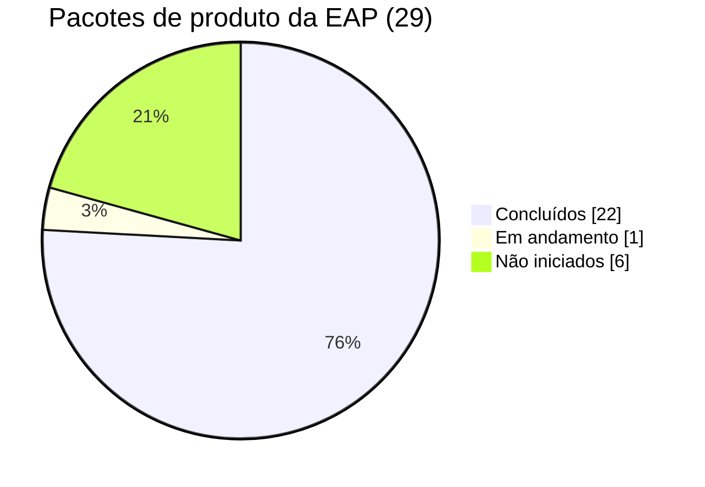

# Monitorar e Controlar o Trabalho do Projeto

> **Processo PMBOK:** 4.5 Monitorar e controlar o trabalho do projeto
> **Área:** Gerenciamento da Integração · **Grupo:** Monitoramento e Controle
> **Relatório de desempenho nº 2** · data de corte: 12/10/2026

---

## 1. Como o projeto é monitorado

| Indicador | Fonte | Frequência |
|-----------|-------|-----------|
| % de pacotes da EAP concluídos | [EAP](../02-Planejamento/EAP.md) | Semanal |
| Fases com "Pronto quando" verificado | [Verificar o Escopo](Verificar-Escopo.md) | Fim de cada fase |
| Desvio de cronograma (planejado × real) | Plano de gerenciamento §5 × log de execução | Semanal |
| Mudanças abertas / aprovadas | [Controle Integrado de Mudanças](Controle-Integrado-de-Mudancas.md) | Semanal |
| Riscos e problemas abertos | Plano §9 + issue log | Semanal |

## 2. Situação por fase

| Fase | Planejado | Real | Pacotes concluídos | Status |
|------|-----------|------|:------------------:|:------:|
| F0 Fundação | 14/08 – 20/08 | Concluída em 12/10 (lint/testes/CI atrasados) | 5 / 5 (100%) | ✅ |
| F1 Persistência | 21/08 – 27/08 | Concluída em 27/08 | 4 / 4 (100%) | ✅ |
| F2 Peças e acessórios | 21/08 – 27/08 | Concluída em 27/08 | 4 / 4 (100%) | ✅ |
| F3 Carrinho | 19/10 – 08/11 | **Concluída em 12/10** (adiantada) | 4 / 4 (100%) | ✅ |
| F4 Agendamento | 09/11 – 22/11 | **Concluída em 12/10** (adiantada) | 4 / 4 (100%) | ✅ |
| F5 Admin | 23/11 – 06/12 | **Antecipada** — autenticação concluída | 1 / 4 (25%) | 🟡 |
| F6 Publicação | 07/12 – 13/12 | Não iniciada | 0 / 4 (0%) | ⬜ |
| Gerenciamento | contínuo | Artefatos de Integração e Escopo prontos | 4 / 5 | 🟡 |

**Progresso geral das entregas de produto:** 22 de 29 pacotes de produto
concluídos ≈ **76%**.

## 3. Análise de desempenho

- **Escopo:** as entregas F1 e F2 foram concluídas **dentro do previsto**
  e verificadas (ver [Verificar o Escopo](Verificar-Escopo.md)).
- **Cronograma:** o pacote 1.1.5 (lint/testes/CI) atrasou ~7 semanas em
  relação ao previsto (agosto), mas foi **concluído em 12/10** pela ação A1.
  Risco R3 (regressões) mitigado: 47 testes automatizados no CI.
- **F3 e F4 adiantadas:** concluídas em 12/10, antes do início planejado
  (19/10 e 09/11). A folga reduz o risco R1 e torna improvável acionar a
  contingência CR-07.
- **Sequência:** a F5 (autenticação) foi **antecipada** em relação à F3/F4.
  A mudança foi registrada como **CR-05** e aprovada com condições.
- **Qualidade:** 31 testes de backend (com banco isolado, incluindo concorrência
  de estoque e de horários) e 16 de frontend rodam no GitHub Actions a cada push/PR.

## 4. Ações corretivas e preventivas

| # | Tipo | Ação | Responsável | Prazo |
|---|------|------|-------------|-------|
| A1 | Corretiva | Concluir o pacote 1.1.5 (lint + testes + CI) **antes** de iniciar a F3 | Equipe | ✅ 12/10/2026 |
| A2 | Corretiva | Commitar e revisar via PR o trabalho de autenticação (1.6.1) | Luiz | ✅ commit 12/10 · PR pendente |
| A3 | Preventiva | Remover o *fallback* de `JWT_SECRET` e trocar a senha seed antes do deploy | Luiz | ✅ 12/10/2026 |
| A4 | Preventiva | Reunião semanal de 15 min para atualizar a EAP e o `plan.md` | GP | Semanal |
| A5 | Preventiva | Se a F3 atrasar mais de 1 semana, acionar a contingência de R1 (F4 como protótipo) | GP | 08/11/2026 |

## 5. Previsão

Mantido o ritmo atual, F3 e F4 cabem até o fim de novembro. A F5 completa
e a F6 são o **caminho crítico** para dezembro; a contingência prevista
no plano de riscos (R1) é usar o Prisma Studio no lugar do CRUD completo
do painel.
